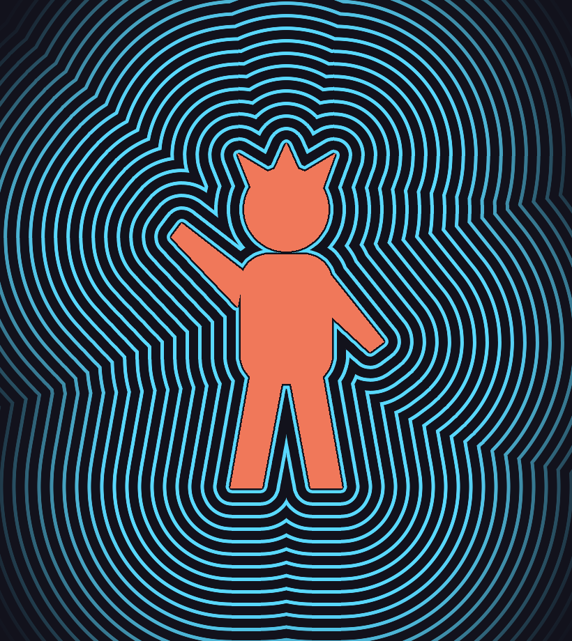

# Aura Contour（オーラ生成）After Effects プラグイン

キャラクターのシルエットから、その輪郭の形をしたボーダーが外側へ何重にも続いていくエフェクトです。
アルファ付きのカラー素材と、白地に黒の2値線画のどちらにも使えます。
エフェクトメニューの **Manga FX → Aura Contour** に入ります。



| プレビュー | 内容 |
|---|---|
| [01_color_basic.png](previews/01_color_basic.png) | アルファ付きカラー素材、単色 |
| [02_color_rainbow_wobble.png](previews/02_color_rainbow_wobble.png) | Rainbow ＋ Wobble（揺らぎ） |
| [03_color_gradient_taper.png](previews/03_color_gradient_taper.png) | Gradient ＋ 外側ほど細く（Outer Width 20%） |
| [04_lineart_over.png](previews/04_lineart_over.png) | 白地の2値線画、Stripes（2色）、Over Original |
| [05_lineart_nofill.png](previews/05_lineart_nofill.png) | 線画で Fill Interior をオフにした場合（内側にも線が出る） |
| [06_anim.gif](previews/06_anim.gif) | Speed でボーダーが外へ流れ続けるアニメーション |
| [07_fill_gradient.png](previews/07_fill_gradient.png) | Style: Fill、Gradient ＋ Wobble（炎のような塗りつぶしオーラ） |
| [08_fill_alternate_bands.png](previews/08_fill_alternate_bands.png) | Style: Fill、Stripes（太い縞の塗りつぶし） |
| [09_fill_plus_lines.png](previews/09_fill_plus_lines.png) | Style: Fill + Lines（塗りの上に線） |
| [10_corner_rounding_0.png](previews/10_corner_rounding_0.png) / [11_corner_rounding_40.png](previews/11_corner_rounding_40.png) | Corner Rounding 0 と 40 の比較（外側の角が丸くなる） |
| [12_color_cycle.gif](previews/12_color_cycle.gif) | Color Cycle: Hue Rotate、1秒で一周してループ |
| [13_barber_pole.gif](previews/13_barber_pole.gif) | 青・赤・白の3色 Stripes ＋ Fill ＋ Palette Loop（同心円のサインポール） |
| [14_five_colors_lines.png](previews/14_five_colors_lines.png) | 5色の Stripes（揺らぎなしのきれいな線） |
| [16_fill_composition_default.png](previews/16_fill_composition_default.png) | 初期設定（Fill Composition オン）で画面の端まで敷き詰める |
| [15_narrow_gaps_zoom.png](previews/15_narrow_gaps_zoom.png) | 拡大：頭と体の間など狭い隙間にもボーダーが入り込む |
| [17_fill_stripes_clean_edge.png](previews/17_fill_stripes_clean_edge.png) | Fill ＋ Stripes でもキャラのきわに余計な細い線が出ない |
| [18_shape_layer.png](previews/18_shape_layer.png) | 空の背景レイヤーに適用し、Shape Layer で別レイヤーのキャラ（移動・縮小・回転あり）の形に合わせる |
| [19_looney_circles.png](previews/19_looney_circles.png) | Ring Shape: Circles ＋ プリセット Retro Rings（ルーニー・テューンズ風、円で切り取らない） |
| [20_hsb_steps_lines.png](previews/20_hsb_steps_lines.png) / [21_hsb_steps_fill.png](previews/21_hsb_steps_fill.png) | HSB Steps：Color 1 から色相・彩度・明度を段階的にずらした自動グラデーション（境目はくっきり） |

プレビューは `test/` のテストツールでプラグインと同じコア処理を実行して作ったものです。

## 仕組み

1. ソース（アルファ／輝度）からシルエットのマスクを作る
2. 必要なら隙間を閉じて内側を塗りつぶし、線画でも「外側の輪郭」だけを取り出す
3. シルエットからの距離場（正確なユークリッド距離変換）を計算する
4. 距離が `Spacing` の倍数になる位置に線を引く → 輪郭の形がそのまま外側へ繰り返される

8 / 16 / 32 bpc、マルチフレームレンダリング、解像度（1/2 など）に対応した SmartFX です。
初期設定（`Fill Composition` オン）では、ボーダーがコンポジションの端まで途切れずに続きます。ボーダーはレイヤーの外まで広がるので、レイヤー境界も自動で拡張します（`Grow Layer Bounds`）。

## ファイル構成

```
aura/
├── CMakeLists.txt        Windows / Mac ビルド
├── mac/Info.plist.in     Mac バンドル用
├── src/
│   ├── Aura.h / Aura.cpp      AE とのつなぎ込み（パラメータ、SmartFX）
│   ├── AuraCore.h / .cpp      画像処理本体（AE SDK 非依存）
│   └── AuraPiPL.r             エフェクト登録情報
├── test/                 AE なしで動くテストツールとサンプル生成スクリプト
└── previews/             出力サンプル
```

## ビルド

After Effects SDK を [Adobe Developer Console](https://developer.adobe.com/after-effects/) からダウンロードして展開しておきます。
`AE_SDK_DIR` には SDK の **Examples** フォルダ（`Headers` / `Util` / `Resources` が入っている所）を指定します。
2022 以降の SDK を想定しています（`PF_REGISTER_EFFECT_EXT2` を使用）。

### Windows（Visual Studio 2022）

「x64 Native Tools Command Prompt for VS 2022」から実行します（PiPL 変換で `cl` を使うため）。

```bat
cmake -S . -B build -G "Visual Studio 17 2022" -A x64 -DAE_SDK_DIR="C:/AfterEffectsSDK/Examples"
cmake --build build --config Release
```

`build/Release/AuraContour.aex` ができます。

### macOS（Xcode）

```sh
cmake -S . -B build -G Xcode -DAE_SDK_DIR="$HOME/AfterEffectsSDK/Examples"
cmake --build build --config Release
```

`build/Release/AuraContour.plugin`（Apple Silicon / Intel ユニバーサル）ができます。
配布する場合は署名と公証が必要です。自分の Mac だけで使うなら署名なしでも動きます。

### CMake を使わない場合

SDK の `Examples/Template/Skeleton` をフォルダごと複製し、`Skeleton.cpp` `Skeleton.h` `SkeletonPiPL.r` を
`src/` の `Aura.cpp` `Aura.h` `AuraCore.cpp` `AuraCore.h` `AuraPiPL.r` に置き換えてプロジェクトに追加してもビルドできます。

## インストール

できた `.aex` / `.plugin` を次のどちらかにコピーして After Effects を再起動します。

- Windows: `C:\Program Files\Adobe\Common\Plug-ins\7.0\MediaCore\`
- macOS: `/Library/Application Support/Adobe/Common/Plug-ins/7.0/MediaCore/`

## パラメータ

### Source（どこを「キャラクター」とみなすか）

| 名前 | 説明 |
|---|---|
| Source Channel | `Alpha`：アルファ付き素材向け。`Luminance (Dark Lines)`：白地に黒線の線画向け。`Luminance (Bright)`：黒地に白線向け |
| Shape Layer | `None`（初期値）ならこのレイヤー自身の形。別のレイヤーを選ぶと、そのレイヤーの形（位置・拡大・回転・親子付けも反映）に沿ってボーダーを出す。背景用のレイヤーに適用するとき用 |
| Threshold | この値以上をシルエットとみなす |
| Fill Interior | 囲まれた内側も塗りつぶして、外側の輪郭だけからボーダーを出す。線画ではオン推奨 |
| Close Gaps | この幅以下の隙間を閉じる。初期値 0 は狭い隙間にもボーダーが入り込む。線画の切れ目から内側に漏れるときだけ上げる |
| Contour Smoothness | 輪郭をなめらかにする（細かい凹凸を拾わない） |

### Rings（ボーダーの形）

| 名前 | 説明 |
|---|---|
| Ring Shape | `Contour`（初期値）キャラの輪郭に沿う / `Circles` `Circle Center` を中心にした同心円 |
| Circle Center | `Circles` の中心 |
| Style | `Lines` 線だけ / `Fill` オーラの範囲を塗りつぶす / `Fill + Lines` 塗りの上に線を重ねる |
| Start Offset | キャラクターから最初のボーダーまでの間隔（初期値 2px）。小さいほど狭い隙間の奥まで線が入る |
| Spacing | ボーダーの間隔 |
| Line Width | 線の太さ |
| Softness | 線の端のぼかし。大きくすると発光っぽくなる |
| Outer Width | 外側の端での線の太さ（%）。100%（初期値）なら全体で同じ太さ。小さくすると外ほど細く（`Fill Composition` オンのときは `Gradient Length` の距離で細くなる） |
| Fill Composition | オン（初期値）でコンポジションの端までボーダーを敷き詰める。このとき `Aura Length` と `Fade Out` は使われない |
| Aura Length | `Fill Composition` オフのとき、オーラが届く距離 |
| Fade Out | `Fill Composition` オフのとき、外側の端をこの距離でフェードアウトさせる |
| Corner Rounding | 外側のボーダーにできる角（腕と体の間などの尖り）を丸める量。0 で輪郭どおり。キャラのすぐ近くは輪郭に沿ったまま、外へ行くほど丸くなる |

### Animation

| 名前 | 説明 |
|---|---|
| Ring Offset | ボーダー全体を外側へずらす。キーフレームで動かせる |
| Speed (px/sec) | 自動で外側へ流れ続ける速さ。マイナスで内向き |
| Wobble Amount / Size / Speed / Seed | ノイズでボーダーを揺らがせる（ブルブルした表現）。初期値 0 ではきれいな線 |

### Color

| 名前 | 説明 |
|---|---|
| Color Preset | 選ぶと Color Mode・Number of Colors・Color 1〜5・Band Shading・Shading Color がまとめて設定される（`Retro Rings` / `Barber Pole` / `Rainbow` / `Fire` / `Ocean` / `Candy` / `Neon` / `Mono`）。そのあと個別に色を変えても構わない。`Custom` は何もしない |
| Color Mode | `Solid` 単色 / `Gradient` 距離で Color 1→最後の色 / `Stripes` 1本（Fill なら1帯）ごとに Color 1→2→…→N→1 と繰り返す / `Rainbow` 1本ごとに色相を回す / `HSB Steps` Color 1 から1本ごとに色相・彩度・明度をずらした色を自動で作る（境目はくっきりのまま） |
| Number of Colors | 使う色の数（1〜5） |
| Color 1〜5 | 使う色。Number of Colors の数だけ前から使われる |
| Gradient Length | Gradient で Color 2 になるまでの距離 |
| Hue Step | Rainbow で1本ごとに回す色相（度） |
| HSB Steps (rings) | `HSB Steps` で Color 1 から最後の色まで何本で到達するか |
| HSB Hue / Saturation / Brightness Shift | `HSB Steps` の最後の色が Color 1 からどれだけずれるか（色相は度、彩度・明度は%） |
| HSB After Last Step | 最後の色まで行ったあと。`Continue`（初期値）最後の色のあとも同じ変化を続けて色を作り、端まで続ける（色相は回り続け、彩度・明度は0%か100%で止まる）/ `Hold` 最後の色のままずっと（例：明→暗のまま）/ `Ping-Pong` 折り返して Color 1 へ戻る（明→暗→明→暗…）/ `Repeat` Color 1 に戻って繰り返す。`Hold` と `Continue` のときは `Color Cycle` の `Palette Loop` はぴったりループしない |
| Band Shading | `Fill` 系で、1帯の中を Shading Color（内側）→帯の色（外側）のグラデーションにする量。帯と帯の境目はくっきりのまま |
| Shading Color | Band Shading の内側の色 |
| Fill Color (Fill + Lines) | `Fill + Lines` のときの塗りの色（線は Color Mode の色） |
| Fill Opacity | 塗りの不透明度 |
| Color Cycle | 色を一定周期でループさせる。`Hue Rotate` 色相が一周する / `Palette Loop` 設定した色の中を順に巡る（Stripes なら縞が外へ流れ、Solid なら全体の色が Color 1→…→N と変わる） |
| Cycle Duration (sec) | 1ループの秒数。この秒数ごとにぴったり元の色に戻る |
| Cycle Offset | ループの開始位置（%）。複数のレイヤーで色をずらしたいときに |

### 出力

| 名前 | 説明 |
|---|---|
| Opacity | オーラの不透明度 |
| Composite | `Behind Original` 元画像の後ろ / `Aura Only` オーラだけ / `Over Original` 元画像の上 / `Add` 加算。Shape Layer を使っているときは、`Behind Original` は `Over Original` と同じになる（背景の平面に隠れないように） |
| Grow Layer Bounds | レイヤーの外までオーラを描く。フルフレームのレイヤーならオフでも同じ |

## 使い方のコツ

- **アルファ付きのキャラ素材**：そのまま適用するだけ。Composite は `Behind Original`。
- **白地の2値線画**：`Source Channel` を `Luminance (Dark Lines)`、`Composite` を `Over Original` に。
  白地は不透明なので Behind だとオーラが隠れます。線が途切れている所から内側に漏れる場合は `Close Gaps` を上げます。
- **延々と流れるオーラ**：`Speed` に `Spacing` と同じ値を入れると1秒で1本分進みます。初期設定のままで画面の端まで流れ続けます。途中で消したいときは `Fill Composition` をオフにして `Aura Length` と `Fade Out` で調整します。
- **太い塗りつぶしのオーラ**：`Style` を `Fill` に。`Color Mode` が `Gradient` なら内から外へのグラデーション、`Stripes` / `Rainbow` なら `Spacing` の幅の太い縞になります。広がりは `Aura Length`、外側のぼかしは `Fade Out`、輪郭の揺らぎは `Wobble` で調整します。
- **ループ素材にする**：`Color Cycle` の `Cycle Duration` と同じ秒数で、ボーダーの動きも1本分進むように `Speed` = `Spacing` ÷ `Cycle Duration` にすると、色と動きの両方がぴったりループします（`Wobble` はループしないので 0 に）。
- **同心円のサインポール**：`Style` = `Fill`、`Color Mode` = `Stripes`、`Number of Colors` = 3 で Color 1〜3 を青・赤・白に。`Color Cycle` = `Palette Loop` にすると、縞が外へ流れて `Cycle Duration` 秒でぴったり元に戻ります。線だけにしたい場合は `Style` = `Lines` のままで同じ設定にします。
- **きれいな線**：輪郭はサブピクセル精度で測っているので、ピクセルの段差がボーダーに出ません。ギザギザした素材なら `Contour Smoothness` を上げるとさらになめらかになります。
- **狭い隙間**：`Close Gaps` = 0、`Start Offset` を小さく、`Spacing` を細かくすると、腕と体の間などの奥まで線が入ります。
- **線幅について**：`Corner Rounding` や `Wobble` で間隔が伸び縮みする所でも、線は `Line Width` の太さのまま描かれます。
- **背景レイヤーにオーラを出す**：キャラの下に平面（背景）を置いてそこに適用し、`Shape Layer` でキャラのレイヤーを選びます。キャラを動かしてもボーダーが追従します。キャラ自身の上にはボーダーが描かれないので、キャラは上のレイヤーのまま見えます。
- **ルーニー・テューンズ風**：`Ring Shape` = `Circles`、`Style` = `Fill`、`Color Preset` = `Retro Rings`、`Start Offset` = 0。`Spacing` で帯の太さ、`Circle Center` で中心を決めます。`Fill Composition` オンなら円で切り取られず画面いっぱいに広がります。
- **自分の色セットを登録する**：色を決めたらエフェクトを選んで「アニメーション → アニメーションプリセットを保存」で .ffx に保存すると、いつでも同じ色で適用できます。
- **くっきりした自動グラデーション**：`Color Mode` = `HSB Steps` で Color 1 だけ決め、`HSB Hue / Saturation / Brightness Shift` でずらし方を決めます。1本（Fill なら1帯）ごとに1色なので、にじまずに段階的に変わります。
- **重いとき**：`Fill Composition` をオフにして `Aura Length` を必要な分だけにすると計算範囲が小さくなります。

## AE なしでの動作確認

```sh
python3 test/run_samples.py /tmp/aura_work previews   # g++ と Pillow が必要
```

`test/aura_test.cpp` はプラグインと同じ `AuraCore` を使って PNG を出力します。

## 検証状況

- コア処理は Linux で実際に動かし、`previews/` の出力で確認済みです。
- プラグイン部分（`Aura.cpp`）は、公開されている AE SDK ヘッダの写しに対して g++ で構文チェックが通ることを確認しました。パラメータ登録・PreRender・SmartRender の流れも擬似ホストから呼んで、範囲計算と出力を確認しています。
- Visual Studio / Xcode での実ビルドと、After Effects 上での動作はまだ確認していません。ビルドエラーや AE の警告が出たら、そのメッセージを貼ってもらえれば直します。
