# Concentration Lines（漫画風 集中線 / 流線）After Effects プラグイン

漫画風の **集中線** と **流線** を描く After Effects 用エフェクトです。
線画だけでなく、カラー素材・実写・透過素材にもそのまま使えます（8 / 16 / 32bpc 対応、SmartFX、マルチフレームレンダリング対応）。

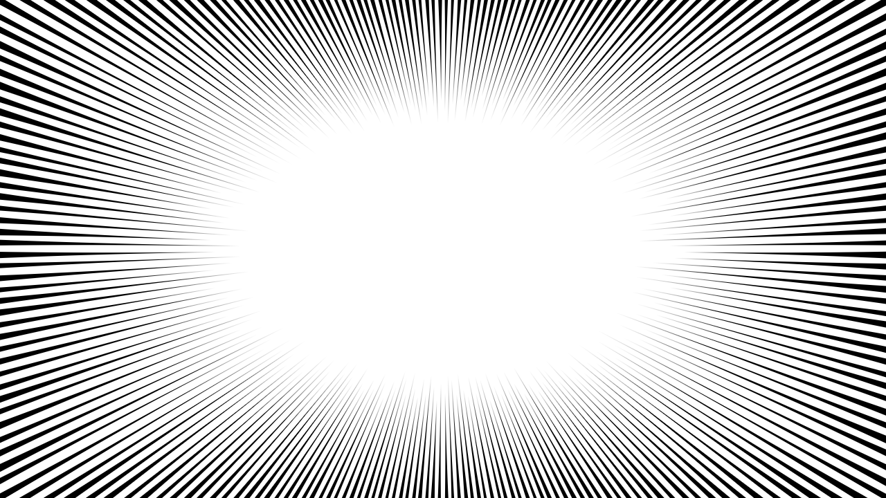

| カラー素材の上に白い集中線 | 透過したキャラの「後ろ」に集中線 |
|---|---|
| 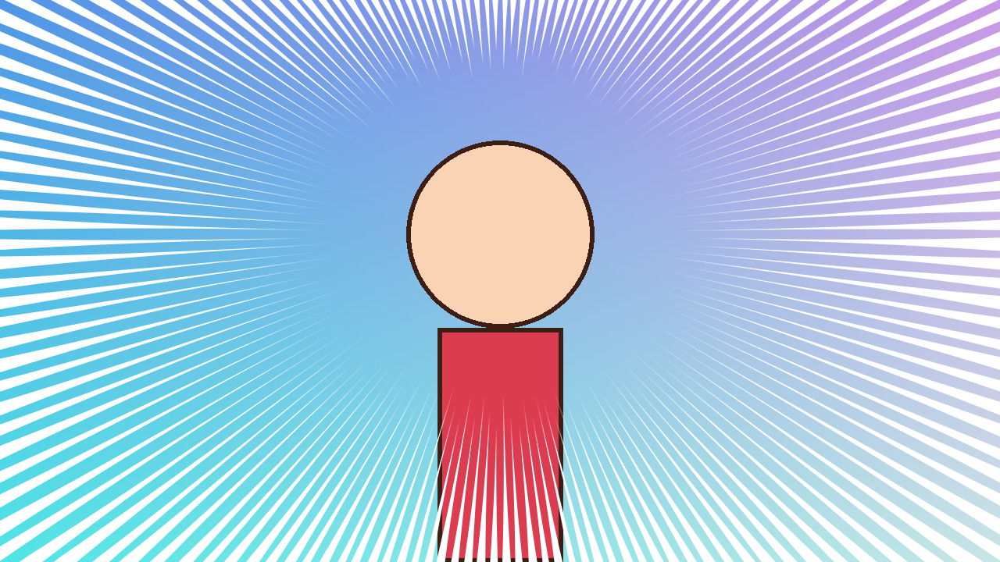 | 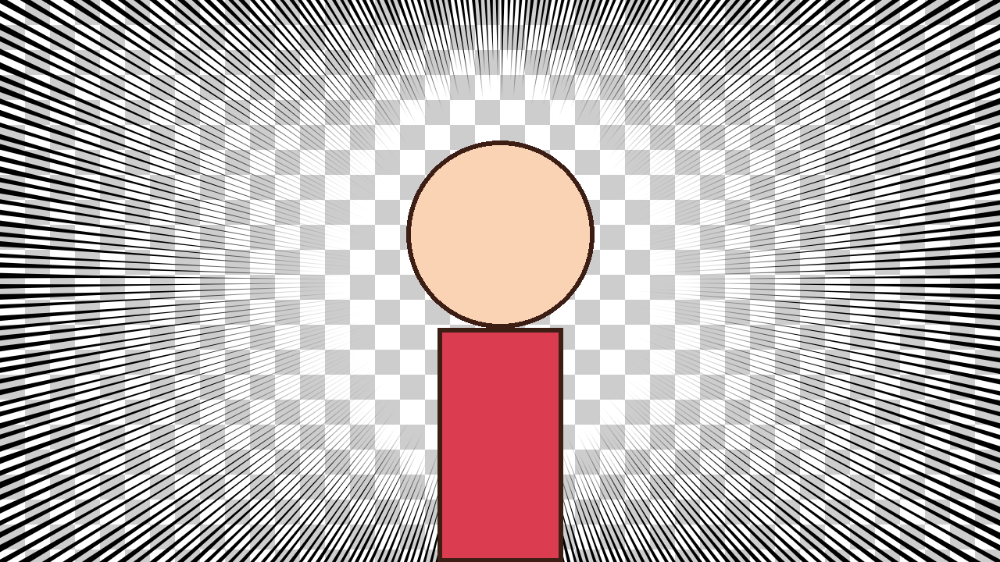 |

| 流線（中央を空ける・カラー） | 線だけ出力（背景透明） |
|---|---|
| 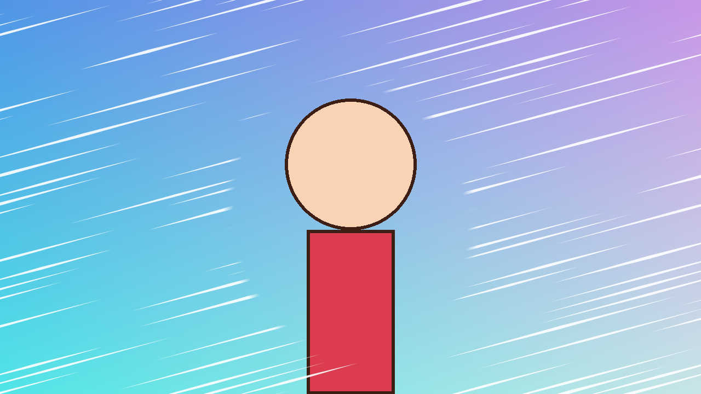 | 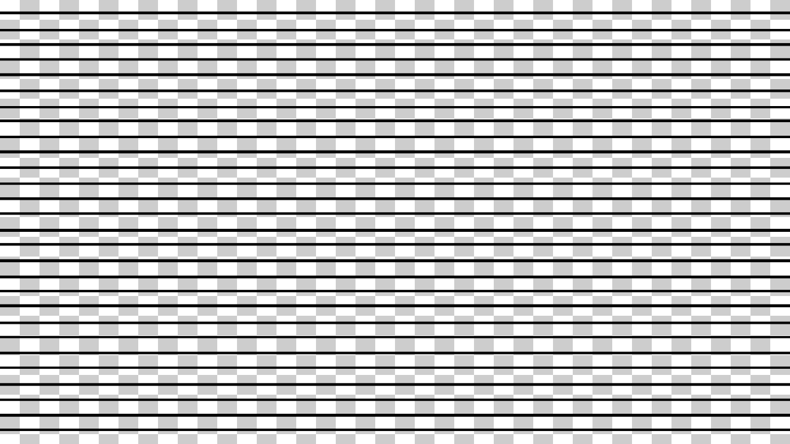 |

※ 上の画像は AE ではなく、同じ描画コードを使うプレビューツール（`tools/preview.cpp`）で生成したものです。

## フォルダ構成

```
concentration-lines/
├─ src/
│  ├─ ConcentrationLinesCore.h   描画コア（SDK 非依存の C++）
│  ├─ ConcentrationLines.cpp/.h  AE とのやり取り（パラメータ・SmartFX）
│  └─ ConcentrationLinesPiPL.r   PiPL リソース
├─ CMakeLists.txt                Windows / Mac 共通のビルド設定
├─ mac/Info.plist
├─ tools/                        AE なしで見た目を確かめるプレビューツール
└─ previews/                     サンプル出力
```

## パラメータ

エフェクトは **エフェクト ＞ Manga FX ＞ Concentration Lines** に入ります。
AE の表示文字化けを避けるため、パラメータ名は英語にしています。

| 表示名 | 意味 | 既定値 |
|---|---|---|
| Type | `Radial (Focus)` = 集中線 / `Parallel (Speed)` = 流線 | Radial |
| Target | 集中線の中心（ターゲット）。エフェクトを選ぶとコンポ画面に ⊕ が出るので、ドラッグして位置を選べます。キーフレームでアニメーションも可 | レイヤー中央 |
| Follow | 自動追従（下記）。`Off` のときは Target の位置を使う | Off |
| Follow Layer | 追従するレイヤー | なし |
| Follow Offset X / Y | 追従位置からのずらし（px）。キャラの顔に合わせたいときなど | 0 / 0 |
| Inner Width / Inner Height | 線を描かない中央の楕円の半径（px）。流線では中央を空ける範囲 | 300 / 200 |
| Inner Shape | 中央の空白の形。`Ellipse` = 楕円 / `Layer Silhouette` = Shape Layer に選んだレイヤー（切り抜いたキャラクターなど）の**不透明な部分の形**に合わせて空ける。キャラが動いたりポーズが変わっても毎フレーム形に沿います（集中線のみ。流線は楕円のまま） | Ellipse |
| Shape Layer | 空白の形に使うレイヤー | なし |
| Shape Margin | 形から線の始点までの余白（px）。マイナスにすると形に食い込む | 20 |
| Shape Smoothness | 形の細かい凹凸（指の間・髪の毛先など）をならす量。0% で形にぴったり、上げるとなめらかな輪郭に | 20% |
| Angle | 楕円の回転。流線では流れる向き | 0° |
| Line Count | **間隔**を決めます。集中線: 一周の本数 / 流線: 1000px あたりの本数（多いほど間隔が詰まる） | 200 |
| Line Width | 線の太さ（px）。線は**外側の端（画面の縁）で一番太く、内側へ向かって細く**なります（筆圧は外側が最強）。遠い隅へ伸びる線ほど外端が太くなるので、画面の縁はどこでも線と隙間の比率が揃います。値は外端の平均的な位置での太さです。線の濃さ（線が占める割合）は**外端が一番濃く**、内側へ向かって薄くなります。外側をもっと黒く埋めたいときはこの値を上げてください | 8 |
| Width Randomness | 太さのばらつき | 30% |
| Spacing Randomness | 間隔のばらつき。0% で完全な等間隔。隣の線と入れ替わらない範囲でずらすので、上げても線が固まらない | 15% |
| Start Randomness | 集中線の始点のばらつき（内側楕円の何%外側まで散らすか） | 25% |
| Taper | 入り抜きの割合。100% = 外端から内側の先端まで一様に細くなるくさび形 / 30% = 外側 70% は太いまま、内側 30% で細くなる。流線では線分の両端の入り抜き | 100% |
| Sharpness | **先端の鋭さ**。0% = 先が丸く太い / 50% = まっすぐなくさび形 / 100% = 針のように細く伸びる | 50% |
| Edge Softness | 線の輪郭のぼかし（px）。0 でくっきり、上げるとやわらかい光のような線に | 0 |
| Wobble | **手描き風のがたつき**（px）。線がわずかに揺れて、定規で引いたような硬さが取れます。2〜6 くらいが自然 | 0 |
| Wobble Size | がたつきの波の長さ（px）。小さいと細かく震え、大きいとゆったり曲がる | 120 |
| Stroke Unevenness | 線の途中の太さのむら。ペン入れのような筆圧の揺れ | 0% |
| Line Length (0=inf) | 線の長さ。0 で画面端まで（流線は途切れない線） | 0 |
| Length Randomness | 長さのばらつき | 30% |
| Inner Feather | 流線で中央を空けるときの境界のぼかし（px） | 20 |
| Color / Opacity | 線の色と不透明度 | 黒 / 100% |
| Random Seed | 線の配置を変える乱数 | 1 |
| Composite | 合成方法（下記） | Over Source |
| **Animation** グループ | 時間で自動的に動かす設定（下記）。すべて 0 なら静止 | 0 |

すべてのパラメータはストップウォッチでキーフレームを打てるので、太さ・本数・鋭さ・空白の大きさなども自由にアニメーションできます。

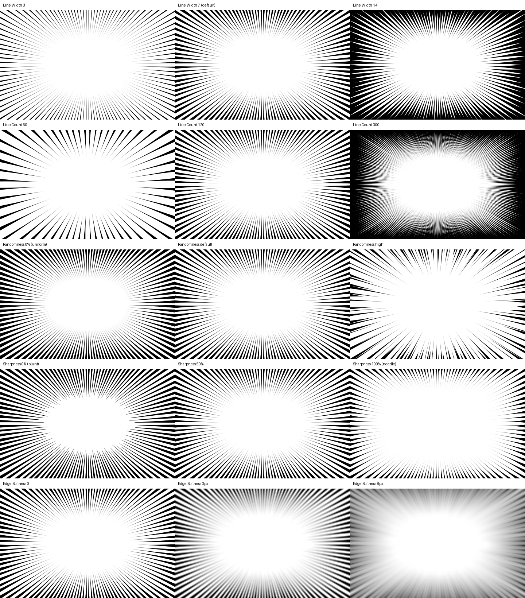

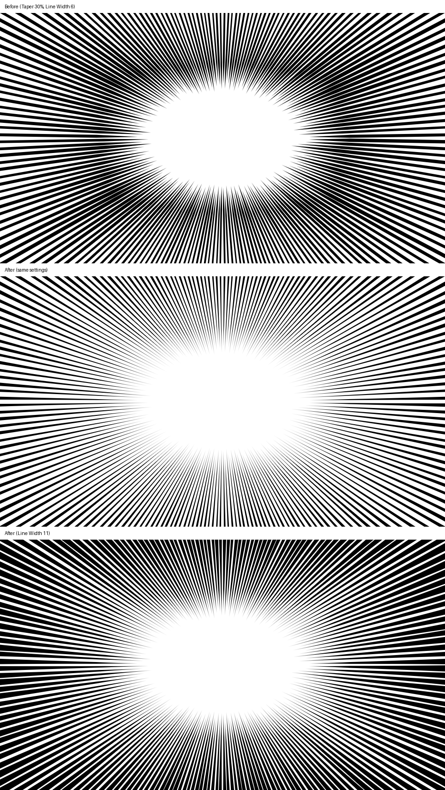

| 空白をキャラの形に合わせる（Inner Shape = Layer Silhouette） | 手描き風のがたつき（Wobble / Stroke Unevenness） |
|---|---|
| 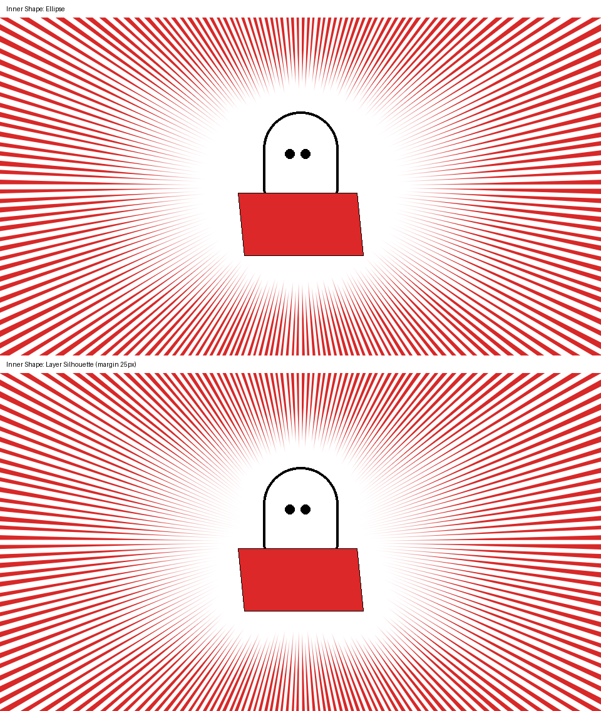 | 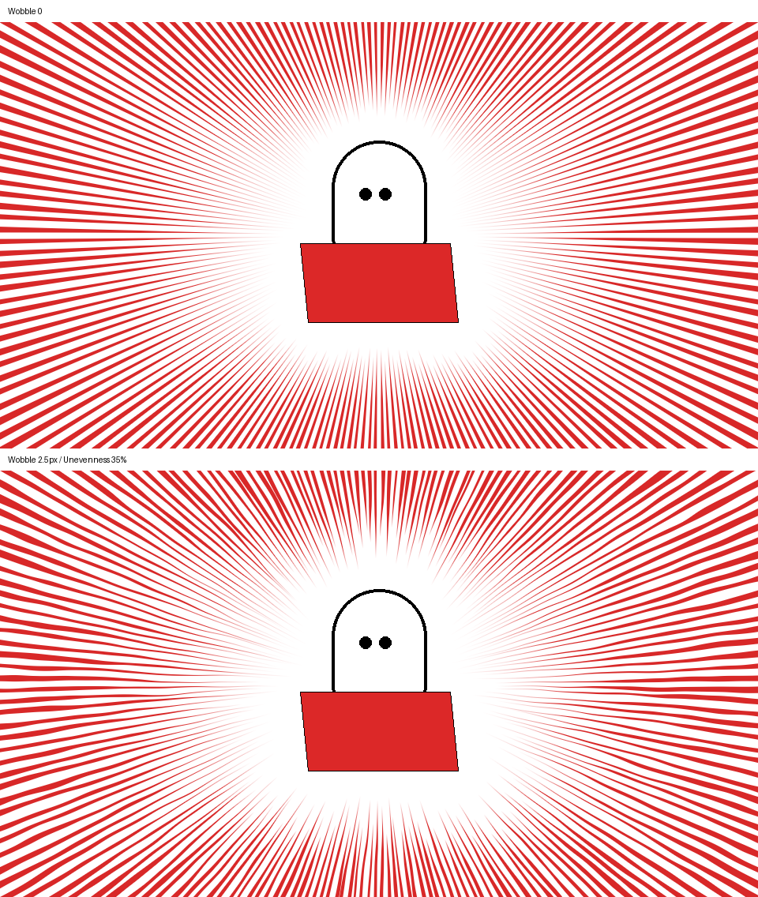 |

### ターゲットと自動追従

- **画面上で選ぶ**: エフェクトコントロールで `Concentration Lines` を選ぶと、コンポ画面に中心の ⊕ が表示されます。ドラッグで好きな位置へ。
- **アニメーション**: `Target` のストップウォッチでキーフレームを打てば、中心が動きます。
- **自動追従**: `Follow` と `Follow Layer` を設定すると、毎フレーム自動で中心がそのレイヤーに付いていきます。
  - `Layer Position`: レイヤーのアンカーポイントに追従。**ヌルやトラッキング結果**（トラッカーで作ったヌル、親子付けしたヌル）に。位置・回転・スケール・親子付けもすべて反映されます。
  - `Layer Alpha Center`: レイヤーの**不透明な部分の重心**に追従。**切り抜いたキャラクター**（ロトブラシ・マスク・キー抜き済みの素材やプリコンプ）を選ぶと、キャラが画面内で動いても中心が付いていきます。中身がプリコンプの中で動いていても大丈夫です。
  - 重心がキャラの胴体寄りになるときは `Follow Offset Y` をマイナスにすると顔の位置へずらせます。

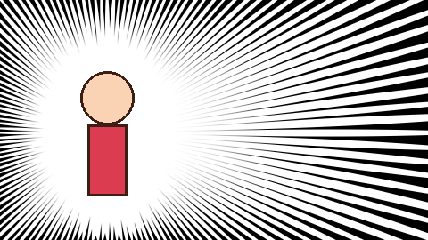

**うまく追従しないときの代わりの方法（エクスプレッション）**: `Target` を Alt（Mac は Option）クリックして次を入れると、AE 標準の仕組みで確実にヌルへ追従します（`"Null 1"` はヌルの名前に変更）。

```
L = thisComp.layer("Null 1");
fromComp(L.toComp(L.anchorPoint))
```

### Animation（自動アニメーション）

| 表示名 | 意味 |
|---|---|
| Flicker Rate (/sec) | 1 秒あたりに線の配置を切り替える回数。アニメの集中線らしい「ちらつき」。8〜12 くらいがおすすめ |
| Rotation Speed (deg/sec) | 集中線をゆっくり回転させる速さ（マイナスで逆回転）。空白の楕円は回りません |
| Pulse Amount / Pulse Rate | 中央の空白が脈打つように伸び縮みする大きさ（%）と速さ（回/秒） |
| Flow Speed (px/sec) | 流線が流れる速さ。`Line Length` を 0 より大きくすると線分が流れて見えます |

| ちらつき + 脈動 | 回転 | 流線が流れる |
|---|---|---|
| 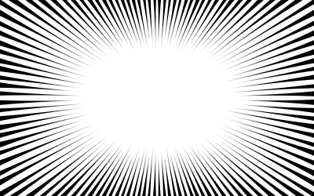 | 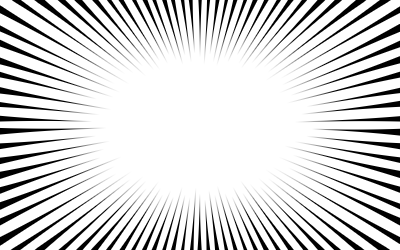 | 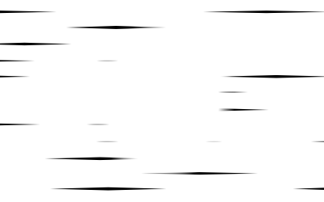 |

### Composite（合成方法）

- **Over Source**: 素材の上に線を描きます。白い背景の線画、カラーの背景どちらにも。
- **Behind Source**: 素材の後ろに線を描きます。切り抜いた（透過した）キャラクターに使うと、キャラの背後にだけ線が入ります。
- **Lines Only**: 線だけを出力し、背景は透明にします。平面レイヤーに適用して別レイヤーとして重ねたいときに。

### 使い方のコツ

- **画面全体に重ねたい**: 調整レイヤーに適用して `Over Source`。下のレイヤーすべての上に線が乗ります。
- **カラー素材で目立たせたい**: 色を白にして不透明度を 70〜90% にすると、背景色が透けて馴染みます。
- **線をちらつかせたい（アニメの集中線のように）**: `Animation ＞ Flicker Rate` を 8〜12 に。
- **キャラに追従させたい**: `Follow` を使います（上記）。`Inner Width/Height` をキーフレームで縮めると「寄り」の演出になります。

## ビルド方法

事前に **After Effects SDK** を Adobe Developer Console からダウンロードしてください（Adobe ID でのログインが必要）。
展開した中の `Examples` フォルダを以下で `<SDK>/Examples` と書きます。

### 方法A: CMake（Windows / Mac 共通）

```sh
cmake -B build -DAE_SDK_ROOT=<SDK>/Examples
cmake --build build --config Release
```

- Windows（Visual Studio 2022, x64）: `build/Release/ConcentrationLines.aex` ができます。
  「x64 Native Tools Command Prompt」から実行すると確実です。
- Mac（Xcode, Apple Silicon と Intel のユニバーサル）: `cmake -G Xcode -B build ...` とすると `build/Release/ConcentrationLines.plugin` ができます。

### 方法B: SDK のサンプル「Skeleton」を流用（CMake がうまくいかないとき）

Adobe 純正のプロジェクト設定をそのまま使う、いちばん確実な方法です。

1. `<SDK>/Examples/Effect/Skeleton` フォルダを丸ごとコピーして `ConcentrationLines` にリネーム。
2. 中の `Skeleton.cpp` / `Skeleton.h` / `SkeletonPiPL.r` / `Skeleton_Strings.cpp` をプロジェクトから外し、
   この `src/` の 4 ファイルを追加します（PiPL は `ConcentrationLinesPiPL.r` を Skeleton の PiPL と同じ扱いにする）。
3. Windows は `Win/Skeleton.sln`、Mac は `Mac/Skeleton.xcodeproj` を開いてビルド。
   Windows では PiPL のカスタムビルドステップのファイル名を `ConcentrationLinesPiPL` に書き換えてください。

### インストール

ビルドした `.aex`（Windows）または `.plugin`（Mac）を次のフォルダに置いて AE を再起動します。

- Windows: `C:\Program Files\Adobe\Common\Plug-ins\7.0\MediaCore\`
- Mac: `/Library/Application Support/Adobe/Common/Plug-ins/7.0/MediaCore/`

## プレビューツール（AE なしで見た目を確認）

描画コアは SDK に依存しないので、普通の C++ コンパイラで動かせます。

```sh
g++ -O2 -std=c++17 -o /tmp/preview tools/preview.cpp
python3 tools/make_previews.py /tmp     # Pillow と numpy が必要。previews/ に PNG を書き出す
```

## 確認できていること / いないこと

- 描画コアはこの環境でコンパイル・実行し、上のプレビュー画像で見た目を確認済みです。
- プラグイン本体は SDK のヘッダ（公開ミラー）に対して構文チェックを通し、PiPL のフラグ値もヘッダの定義と一致することを確認済みです。
- **AE 上での実ビルド・動作確認はまだです**（この環境には Windows / Mac と AE が無いため）。
  初回ビルドでエラーが出たら、そのメッセージを送ってもらえれば直します。特に次の点は SDK のバージョンで差が出る可能性があります。
  - `Iterate8Suite2` / `Iterate16Suite2` / `IterateFloatSuite2`（古い SDK では `...Suite1`）
  - 起動時に「PiPL のフラグが一致しない」という警告が出た場合は、表示された値を `ConcentrationLinesPiPL.r` の `AE_Effect_Global_OutFlags(_2)` に入れてください。
- 自動追従は AEGP（AE の内部 API）で追従レイヤーの位置や変形を取得しています。追従レイヤーを動かしても画面がすぐ更新されない場合は、フレームを移動するか、上のエクスプレッションの方法を使ってください（AE 上で未確認のため念のため）。
- アニメーション機能のため「パラメータが変わらなくても毎フレーム描き直す」設定にしています。静止で使うときもレンダリングは各フレーム行われます。
- 低解像度プレビュー（1/2, 1/4）でも線の太さ・間隔が同じ見た目になるよう、ダウンサンプルを考慮しています。
