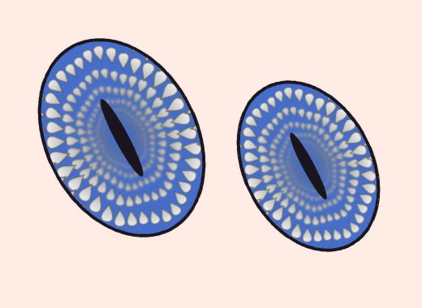

# Iris Kaleidoscope（瞳の万華鏡）After Effects プラグイン

キャラクターの目の塗りの中だけに、登録した素材（模様レイヤー）を瞳孔のまわりへ放射状に並べ、
中心へ向かってどんどん小さくなる万華鏡のような模様を作るエフェクトです。
揺れながら回転し、奥ほどぼけて暗くなるので、瞳の奥へ吸い込まれるような奥行きが出ます。
エフェクトメニューの **Manga FX → Iris Kaleidoscope** に入ります。



| プレビュー | 内容 |
|---|---|
| [00_before.png](previews/00_before.png) | 適用前（目の塗りレイヤー＋上に線画） |
| [01_default_petal.png](previews/01_default_petal.png) | 初期設定（内蔵の花びら、36個／周。目の形の楕円のまま、まぶたの下まで続く） |
| [02_tint_gradient_dof.png](previews/02_tint_gradient_dof.png) | Overlay: Tint（外側シアン→内側紫）＋ 奥ほど暗く・ぼける |
| [03_star_wavy.png](previews/03_star_wavy.png) | 内蔵の星、Wave Amount を上げて波打つリングに |
| [04_custom_layer.png](previews/04_custom_layer.png) | Pattern Layer に自作の花の素材を指定 |
| [05_diamond_twist_screen.png](previews/05_diamond_twist_screen.png) | ひし形 ＋ Twist（らせん）＋ Blend: Screen |
| [06_analog_keycolor.png](previews/06_analog_keycolor.png) | 紙に描いたアナログの目（ムラ・にじみあり）を Key Color で抜いて適用 |
| [07_focus_center.png](previews/07_focus_center.png) | Focus Depth 100%（中心にピント、外側がぼける） |
| [09_fine_72copies.png](previews/09_fine_72copies.png) | Copies per Ring 72 の細かい模様 |
| [10_reference_motif.png](previews/10_reference_motif.png) | 参考の手描き素材（クマ）を 18個／周で並べた例 |
| [08_anim.gif](previews/08_anim.gif) | 回転 ＋ 揺れ ＋ 波 ＋ 中心へ流れ込むアニメーション |

プレビューは `test/` のテストツールでプラグインと同じコア処理を実行して作ったものです。

## 使い方

1. 目の塗り（白目を除いた虹彩の色）のレイヤーにエフェクトをかけます。線画は上のレイヤーに置いたままで大丈夫です。
2. 模様にしたい素材をコンポジションに置き（非表示で可）、`Pattern Layer` に指定します。
   素材の透明な余白は自動で切り詰められ、**素材の上側が目の外側**を向くように並びます。
   何も指定しないときは内蔵の図形（`Built-in Shape`）が使われます。
3. 両目が同じレイヤーにあっても、目ごとに中心と楕円の形を自動で見つけます。

### 塗りが2値化されていない場合（アナログ・スキャン素材など）

- 目の塗りだけが別レイヤーになっていてフチがやわらかい場合は `Mask Source: Layer Alpha` のままで使えます（アルファの濃淡がそのまま効きます）。
- 紙ごとスキャンした絵など1枚の画像のときは `Mask Source: Key Color` にして、`Key Color` を目の塗りの色にスポイトで合わせます。
  ムラが残るときは `Key Tolerance` / `Key Softness` を上げ、フチのギザギザは `Mask Feather` でならします。
  小さな絵の具の飛び（`Min Eye Size` 未満のかたまり）は目として扱いません。
- 瞳孔などで塗りに穴があいていても、目の中心は塗り全体から求めます。

## パラメータ

### Eye Mask（どこに適用するか）
| 名前 | 内容 |
|---|---|
| Mask Source | `Layer Alpha`：レイヤーの不透明部分／`Key Color`：指定色に近い部分 |
| Key Color / Key Tolerance / Key Softness | Key Color のときの色・許容範囲・境界のやわらかさ |
| Mask Choke | ＋でマスクを内側へ縮める、−で広げる（px） |
| Mask Feather | マスクのフチのぼかし（px） |
| Min Eye Size | これより小さいかたまりは無視（直径 px） |

### Center（中心と形）
| 名前 | 内容 |
|---|---|
| Center Mode | `Auto (Each Eye)`：目ごとに自動／`Manual Point`：`Manual Center` の位置を中心にする |
| Fit Eye Shape | 100%（初期値）：リングが目の楕円の形に沿う、0%：正円 |
| Iris Size | 模様の楕円の大きさ（見えている目に対する割合）。100% を超えるとまぶたの下にも模様が続いているように切れて見える（初期値 125%） |
| Pupil Size | 中心の模様を出さない範囲（目の大きさに対する割合）。0% で中心まで無限に続く |

### Pattern（並べ方）
| 名前 | 内容 |
|---|---|
| Pattern Layer | 並べる素材のレイヤー（アニメーションする素材も可） |
| Built-in Shape | 素材がないときの内蔵図形（Petal / Diamond / Dot / Star） |
| Copies per Ring | 1周に並べる数（最大360）。増やすほど素材が小さく、リングも細かくなる |
| Ring Spacing | リングの間隔（100% で素材の縦横比がそのまま保たれる） |
| Copy Size | 1マスに対する素材の幅。100% を超えると隣どうしが重なる（最大300%）。素材はマスで切られず、形を保ったまま描かれる |
| Copy Rotation | 素材ごとの向き |
| Mirror Copies | 1つおきに左右反転（万華鏡らしい左右対称） |
| Ring Stagger | 1つおきのリングを半マスずらす量 |

### Motion（動き）
| 名前 | 内容 |
|---|---|
| Rotation / Rotation Speed | 回転角と、1秒あたりの回転速度（度） |
| Sway Amount / Sway Speed | 左右に揺れる角度と速さ（Hz） |
| Sway Lag | 内側のリングほど揺れが遅れて伝わる量（うねるような動き） |
| Twist | リングごとにずらす角度（らせん） |
| Flow Speed | リングが中心へ吸い込まれていく速さ（リング／秒）。マイナスで外へ |
| Wave Amount / Wave Count / Wave Speed | リングを波打たせる強さ・1周の波の数・速さ（スケッチのような波形の輪） |

### Depth（奥行き）
| 名前 | 内容 |
|---|---|
| Depth Fade / Fade Color | 中心へ行くほど `Fade Color` に近づける量 |
| Blur Amount | ピントから外れた部分の最大ぼかし（px、被写界深度） |
| Focus Depth | ピントの位置（0%：目のフチ、100%：瞳孔） |
| Focus Range | ピントが合ったままの範囲 |

中心ほど素材が小さくなるので、細かすぎる部分は自動でなめらかに平均されます（チラつき防止）。

### Color Overlay（色）
| 名前 | 内容 |
|---|---|
| Overlay Mode | Off / Tint（素材の明暗を保って色付け）/ Multiply / Screen / Normal |
| Outer Color / Inner Color | 外側→中心へのグラデーション（同じ色にすれば単色） |
| Overlay Amount | 効きの強さ |

### 出力
| 名前 | 内容 |
|---|---|
| Blend Mode | 模様を目の塗りに重ねる方法（Normal / Multiply / Screen / Add / Overlay） |
| Opacity | 模様の不透明度 |
| Composite | `Over Original`：元の絵の上に模様／`Pattern Only`：目の中の模様だけ |

## 仕組み

1. 塗りからマスクを作り（アルファ or キーカラー、チョーク・フェザー）、つながったかたまりごとに目として認識
2. 目ごとに重心と2次モーメントから中心と楕円（向き・縦横比）を求め、それを `Iris Size` 倍に広げた楕円を模様の基準にする。目の形は「眼球の上にかぶさった切れ目」として扱い、模様はその外にも続いている
3. 楕円を正円に直した座標で「log(半径), 角度」の空間（等角写像）に素材の位置を並べる
   → 中心へ向かって一定の比率で小さくなる無限トンネルになる
4. 素材は各位置に「回転・拡大縮小だけの形のまま」描く（マスで切らないので輪郭がなめらか。重なったら外側の輪が手前）
5. 素材はミップマップ（ガウシアンピラミッド）から読み、小さくなった分とピントのずれの分だけぼかす

8 / 16 / 32 bpc、マルチフレームレンダリング、解像度（1/2 など）に対応した SmartFX です。

## ファイル構成

```
iris-kaleidoscope/
├── CMakeLists.txt          Windows / Mac ビルド
├── mac/Info.plist.in       Mac バンドル用
├── src/
│   ├── Kaleido.h / Kaleido.cpp      AE とのつなぎ込み（パラメータ、SmartFX）
│   ├── KaleidoCore.h / .cpp         画像処理本体（AE SDK 非依存）
│   └── KaleidoPiPL.r                エフェクト登録情報
├── test/                   AE なしで動くテストツールとサンプル生成スクリプト
└── previews/               出力サンプル
```

## ビルド

ビルドする場合は `AE_SDK_DIR` に SDK の **Examples** フォルダを指定します。

```sh
# Windows（x64 Native Tools Command Prompt for VS 2022）
cmake -S . -B build -G "Visual Studio 17 2022" -A x64 -DAE_SDK_DIR="C:/AfterEffectsSDK/Examples"
cmake --build build --config Release        # → build/Release/IrisKaleidoscope.aex

# macOS
cmake -S . -B build -G Xcode -DAE_SDK_DIR="$HOME/AfterEffectsSDK/Examples"
cmake --build build --config Release        # → build/Release/IrisKaleidoscope.plugin
```

### プレビューの作り直し（AE 不要）

```sh
python3 test/run_samples.py /tmp/kaleido_work previews
```
